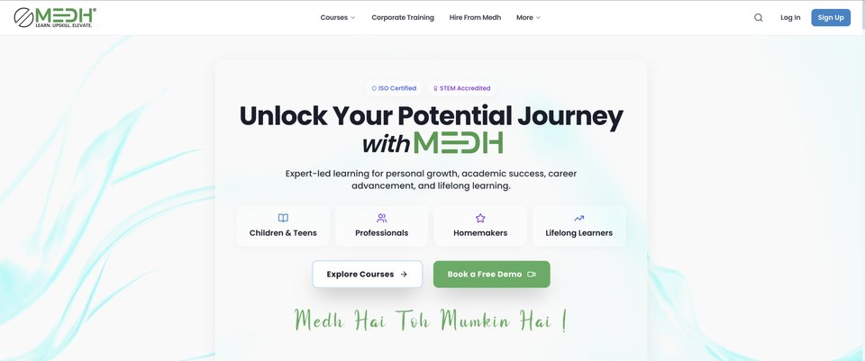
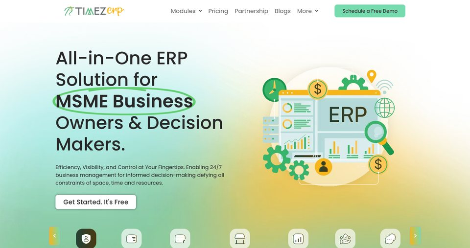

### Automation Software Developer

I build the products behind the orbit: workflow systems, admin platforms, and realtime software.

B.Tech CSE (AI & ML) · Faridabad, India

[sanehi.in](https://sanehi.in) · [esampark.org](https://esampark.org) · [GitHub](https://github.com/sansanehi) · [X](https://x.com/Sansanehi)

---

## Flagship

The three products on [esampark.org](https://esampark.org). Same operating standard, three surfaces.

<table>
  <tr>
    <td width="33%" align="center">
      
    </td>
    <td width="33%" align="center">
      
    </td>
    <td width="33%" align="center">
      
    </td>
  </tr>
  <tr>
    <td align="center">
      <a href="https://esampark.org"><b>esampark.org</b></a> 
      Tech triad site. Next.js, TypeScript, and the 3D product scene that introduces BPO, Medh, and TimezERP.
    </td>
    <td align="center">
      <a href="https://medh.co"><b>medh.co</b></a> 
      Learning product. Courses, live classes, and paths for students, professionals, and corporate training.
    </td>
    <td align="center">
      <a href="https://timezerp.com"><b>timezerp.com</b></a> 
      MSME ERP. Operations, inventory, sales, HR, and the admin surface owners actually run.
    </td>
  </tr>
</table>

Under those front doors: role-based admin, lead and content workflows, audit history, queued work, and media on AWS S3. TypeScript and Zod at the boundary. MongoDB and Payload for the data. Redux Saga for the pipelines.

---

## Also shipped

[Inventory Manager](https://github.com/sansanehi/Inventory-Manager) — company stock, not a spreadsheet with a login.

[Real-Time Tracker](https://github.com/sansanehi/Real-Time-Tracker) — live tracking on Node.js, Express, and Socket.io.

---

## Stack

---

## GitHub

---

Open to automation and product-engineering work.

[sanehi.in](https://sanehi.in) · [esampark.org](https://esampark.org) · [medh.co](https://medh.co) · [@Sansanehi](https://x.com/Sansanehi)

